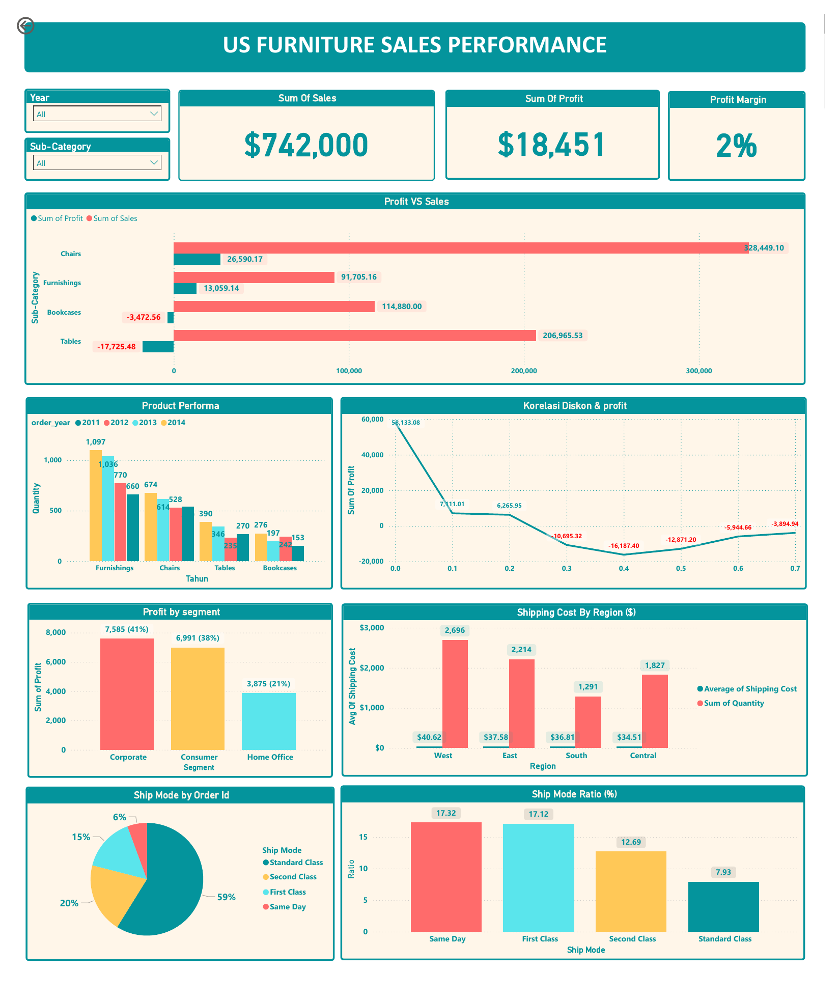

<div align="center">

# 🪑 US Furniture Sales Performance
### Data Analytics & Gen AI Project: Global Superstore

*Capstone Project | RevoU × MSIB Batch 7 | Team 4 "Merauke"*


</div>

---

## 📌 Ringkasan

Repositori ini berisi proyek akhir (*capstone*) **Data Analytics & Gen AI** dari program **Magang dan Studi Independen Bersertifikat (MSIB) Batch 7** bersama **RevoU**.

Tim kami menganalisis dataset **Global Superstore** yang bisa diakses melalui Kaggle https://www.kaggle.com/datasets/apoorvaappz/global-super-store-dataset,  Dataset ini memfokuskan analisis pada satu pertanyaan bisnis: **bagaimana performa penjualan kategori Furniture di pasar Amerika Serikat, dan di mana profitnya bocor?**

Hasilnya adalah dashboard interaktif **Power BI** yang mengubah ribuan baris transaksi menjadi gambaran yang mudah dibaca oleh pengambil keputusan.



---


## 🎯 Latar Belakang & Tujuan

Penjualan yang tinggi belum tentu berarti bisnis yang sehat. Pada kategori Furniture di pasar AS, omzet mencapai ratusan ribu dolar, tetapi margin keuntungannya sangat tipis. Proyek ini dibuat untuk menjawab pertanyaan berikut:

1. Sub-kategori mana yang menyumbang penjualan dan profit terbesar, dan mana yang justru merugi?
2. Bagaimana tren kuantitas penjualan tiap sub-kategori dari tahun ke tahun?
3. Apakah diskon berkorelasi dengan turunnya profit?
4. Segmen pelanggan mana yang paling menguntungkan?
5. Bagaimana pola biaya dan pemilihan metode pengiriman antar wilayah?

---

## 📊 Sorotan Hasil Analisis

| Indikator | Nilai |
|---|---|
| **Total Sales** | **$742.000** |
| **Total Profit** | **$18.451** |
| **Profit Margin** | **2%** |

> Angka di atas mencakup empat sub-kategori Furniture di pasar AS (semua tahun, tanpa filter).

### Temuan Utama

**1. Penjualan besar, profit tipis.** Margin hanya 2%. Artinya, hampir seluruh pendapatan habis oleh biaya dan potongan harga.

**2. Performa tiap sub-kategori sangat timpang.**

| Sub-Category | Sales | Profit | Catatan |
|---|---:|---:|---|
| Chairs | $328.449 | $26.590 | Penjualan dan profit tertinggi |
| Tables | $206.966 | **−$17.725** | Penjualan nomor dua, tetapi kerugian terbesar |
| Bookcases | $114.880 | **−$3.473** | Merugi |
| Furnishings | $91.705 | $13.059 | Sehat, dengan kuantitas terjual tertinggi |

**3. Diskon tinggi menggerus profit.** Pada grafik korelasi diskon dan profit, profit berada di sisi positif ketika diskon rendah (0,0 sampai 0,2). Profit berbalik negatif begitu diskon mencapai 0,3 ke atas.

**4. Furnishings paling laku.** Produk ini memimpin dari sisi kuantitas di semua tahun (2011–2014), dengan puncak 1.097 unit pada 2014.

**5. Segmen Corporate paling menguntungkan.** Kontribusi profit: Corporate 41%, Consumer 38%, Home Office 21%.

**6. Biaya pengiriman berbeda antar wilayah.** Rata-rata biaya pengiriman tertinggi ada di West ($40,62) dan terendah di Central ($34,51). West juga mencatat kuantitas terbesar.

**7. Standard Class mendominasi.** Metode ini dipakai pada 59% order, disusul Second Class (20%), First Class (15%), dan Same Day (6%).

### 💡 Rekomendasi Bisnis

- **Batasi diskon** agar tidak melewati sekitar 20%, terutama pada Tables dan Bookcases. Data menunjukkan profit berbalik negatif pada diskon 30% ke atas.
- **Tinjau ulang harga dan biaya Tables**, karena kategori ini menjual banyak tetapi paling banyak merugi.
- **Jadikan Chairs dan Furnishings sebagai tulang punggung profit**, misalnya lewat bundling atau promosi non-diskon.
- **Perkuat segmen Corporate** dengan penawaran B2B atau pembelian dalam jumlah besar.
- **Optimalkan logistik di wilayah West** yang biayanya paling tinggi.

> ⚠️ Rekomendasi bersifat hipotesis berbasis data historis 2011–2014 dan perlu divalidasi sebelum diterapkan.

---

## 🗂️ Dataset

**Sumber:** Global Superstore, dataset transaksi ritel yang umum dipakai untuk latihan analitik.

| Atribut | Keterangan |
|---|---|
| Jumlah baris | 51.290 transaksi |
| Jumlah kolom | 23 (versi tim) |
| Periode | 2011 – 2014 |
| Cakupan | 7 pasar (APAC, LATAM, EU, US, EMEA, Africa, Canada), 147 negara |
| Pelanggan | 1.590 pelanggan unik |
| Kategori | Furniture, Office Supplies, Technology |
| Subset analisis | **Country = United States** dan **Category = Furniture** (2.121 baris) |

**Kolom utama:** `Order ID`, `Order Date`, `Ship Date`, `Ship Mode`, `Customer ID`, `Segment`, `City`, `State`, `Country`, `Market`, `Region`, `Product ID`, `Category`, `Sub-Category`, `Product Name`, `Sales`, `Quantity`, `Discount`, `Profit`, `Shipping Cost`, `Order Priority`.

### Dua file dataset di repositori

| File | Format | Keterangan |
|---|---|---|
| `Global_Superstore2.csv` | Pemisah `;`, encoding ISO-8859, tanggal `DD/MM/YYYY`, 24 kolom (termasuk `Postal Code`) | Versi mentah dari sumber |
| `[KM SEP24 TA] Final Project-Dataset- Merauke - Team 4 - US (Furniture) - GlobalSuperstore (Original Dataset).csv` | Pemisah `,`, UTF-8, tanggal `DD-MM-YYYY`, 23 kolom | Versi yang disiapkan tim untuk analisis |

> **Catatan kualitas data:** beberapa nilai pada kolom `Sales` dan `Profit` di file CSV tersimpan sebagai teks dengan pemisah titik (contoh: `7.621.845`), sehingga perlu dibersihkan dan dikonversi ke tipe numerik sebelum dihitung.

---

## 🛠️ Alur Kerja

```
Dataset mentah  →  Pembersihan & persiapan data  →  Pemodelan (DAX)  →  Visualisasi  →  Insight & rekomendasi
```

1. **Pemahaman data:** eksplorasi struktur kolom, tipe data, dan cakupan periode.
2. **Persiapan data:** penyeragaman format angka dan tanggal, lalu pemfilteran subset US Furniture.
3. **Pemodelan di Power BI:** pembuatan *measure* DAX untuk KPI dan pelabelan visual (contoh: `Formatted Sales`, `Formatted Profit`, `Margin Total`, `Ratio`, `Color Profit`).
4. **Visualisasi:** satu halaman dashboard dengan slicer **Year** dan **Sub-Category**.
5. **Analisis & rekomendasi:** merangkum temuan menjadi tindakan bisnis.

---

## 📈 Isi Dashboard

| Visual | Fungsi |
|---|---|
| KPI Card (Sales, Profit, Profit Margin) | Ringkasan performa keseluruhan |
| Profit vs Sales (bar chart) | Membandingkan penjualan dan profit tiap sub-kategori |
| Product Performance (column chart) | Kuantitas terjual per sub-kategori per tahun |
| Korelasi Diskon & Profit (line chart) | Melihat dampak diskon terhadap profit |
| Profit by Segment | Kontribusi profit Corporate, Consumer, Home Office |
| Shipping Cost by Region | Biaya pengiriman rata-rata dan kuantitas per wilayah |
| Ship Mode by Order ID (pie chart) | Komposisi metode pengiriman |
| Ship Mode Ratio | Rasio tiap metode pengiriman |
| Slicer Year & Sub-Category | Filter interaktif |

---

## 🧰 Teknologi

- **Microsoft Power BI Desktop** untuk pemodelan dan visualisasi
- **DAX** untuk *measure* dan kalkulasi KPI
- **CSV** sebagai sumber data
- **Generative AI** sebagai bagian dari program (lihat bagian di bawah)

---

## 📁 Struktur Repositori

```
Data-Analytics-and-Gen-AI-Project/
├── assets/
│   └── dashboard-preview.png                  # Pratinjau dashboard untuk README
├── CAPSTONE RevoU.pdf                         # Hasil dashboard (versi PDF)
├── Dashboard - DA - Team 4 Merauke.pbix       # File dashboard Power BI
├── Global_Superstore2.csv                     # Dataset mentah
├── [KM SEP24 TA] ... (Original Dataset).csv   # Dataset versi tim (US Furniture)
└── README.md
```

---

## 🚀 Cara Menjalankan

1. **Clone repositori**
   ```bash
   git clone https://github.com/ashafamultazam/Data-Analytics-and-Gen-AI-Project.git
   cd Data-Analytics-and-Gen-AI-Project
   ```
2. **Install Power BI Desktop** (gratis, hanya untuk Windows) dari situs resmi Microsoft.
3. **Buka** file `Dashboard - DA - Team 4 Merauke.pbix`.
4. Jika Power BI meminta lokasi sumber data, arahkan ke file CSV di folder ini melalui **Transform data → Data source settings**.
5. Gunakan slicer **Year** dan **Sub-Category** untuk menjelajahi data.

Jika tidak memiliki Power BI, lihat hasil dashboard pada `CAPSTONE RevoU.pdf`.

---

## ⚠️ Keterbatasan

- Data berhenti di **2014**, sehingga kondisi pasar saat ini bisa berbeda.
- Analisis berfokus pada **satu kategori di satu pasar**, jadi tidak mewakili seluruh bisnis.
- Hubungan diskon dan profit adalah **korelasi**, bukan bukti sebab-akibat. Biaya produk dan faktor lain tidak dianalisis.
- Dataset Global Superstore adalah data latihan dan bukan data bisnis riil.

---

## 👥 Tim

**Team 4 – Merauke** | RevoU × MSIB Batch 7 (KM SEP24)

| Nama | Peran | Profil |
|---|---|---|
| Ashafa Multazam | Data Analyst | [GitHub](https://github.com/ashafamultazam) |

---

## 🙏 Ucapan Terima Kasih

- **RevoU** dan program **MSIB** atas bimbingan dan kesempatan belajar
- Mentor dan fasilitator Batch 7
- Pembuat dataset **Global Superstore**

---

<div align="center">

⭐ Jika proyek ini bermanfaat, beri bintang pada repositori ini.

</div>
